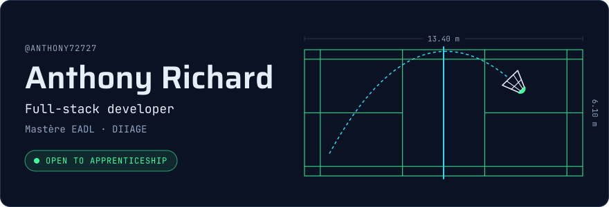
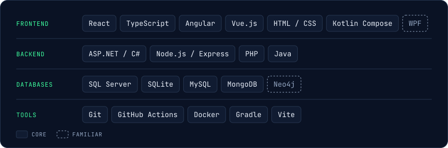
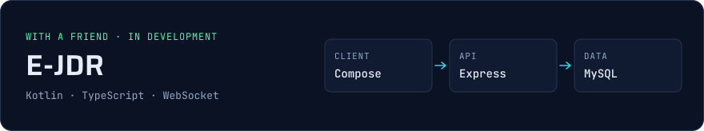
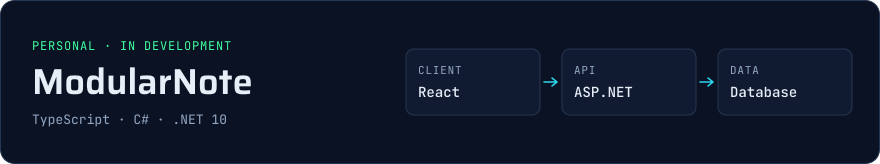
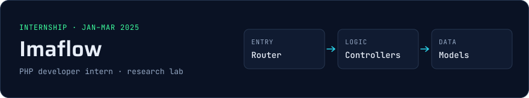
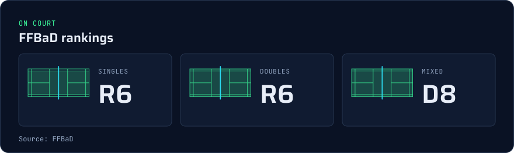
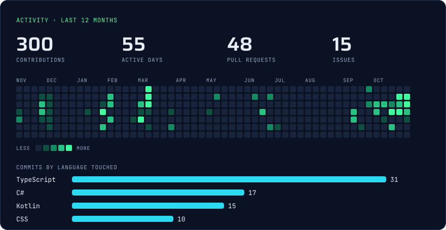
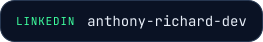
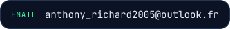
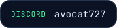

<picture><source media="(max-width: 640px)" srcset="assets/banner-mobile.svg"></picture>

## About

I'm a developer studying for the Mastère EADL at DIIAGE, and I'm looking for an apprenticeship as a full-stack developer. I started with computer science at IUT de Dijon, then got my first professional experience as a PHP developer intern at the Imaflow lab.

I care about code that stays easy to change, so my recent projects use clean architecture on both the client and the server. Away from the keyboard, you'll find me on a badminton court or playing tabletop RPGs with friends.

Pronouns: he/him

## Skills

<picture><source media="(max-width: 640px)" srcset="assets/skills-mobile.svg"></picture>

## Projects

<picture><source media="(max-width: 640px)" srcset="assets/project-ejdr-mobile.svg"></picture>

An app I'm building with a friend so we can run our tabletop RPG sessions remotely, with campaigns, character sheets, friend groups and live sessions.

**Stack:** Kotlin, Compose Multiplatform, Node.js, TypeScript, Express, MySQL, WebSocket 
**Code:** [Frontend](https://github.com/Yorobro/E-JDR-Frontend) · [Backend](https://github.com/Yorobro/E-JDR-Backend)

<picture><source media="(max-width: 640px)" srcset="assets/project-modularnote-mobile.svg"></picture>

A web app to write down ideas, then see them on a canvas with the links between them. The React client and the ASP.NET API both follow clean architecture, with unit and integration tests on the API.

**Stack:** React, TypeScript, TanStack Query, ASP.NET, .NET 10 
**Code:** [ModularNote](https://github.com/Anthony72727/ModularNote)

### Experience

<picture><source media="(max-width: 640px)" srcset="assets/project-imaflow-mobile.svg"></picture>

I took over and improved the lab's existing intranet, which the team relies on day to day. It covers service requests, samples, clients and teams, equipment, pricing and invoicing, with PDF and CSV exports. I also started moving its code to a clearer structure with a router, controllers, services and models.

**Stack:** PHP, HTML, CSS

## Badminton

Badminton is my favourite way to switch off. It rewards the same things as good engineering: solid foundations first, then clean technique and quick decisions under pressure.

<picture><source media="(max-width: 640px)" srcset="assets/badminton-mobile.svg"></picture>

## GitHub stats

<picture><source media="(max-width: 640px)" srcset="assets/stats-mobile.svg"></picture>

## Contact

